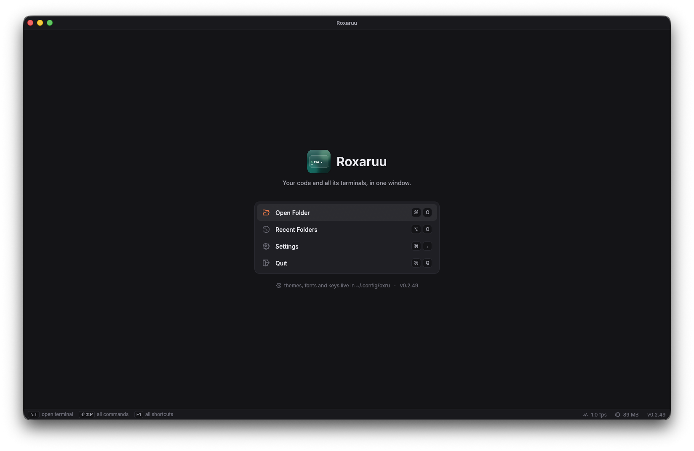

# Roxaruu

**A keyboard-first code editor with terminals built in.**

Every action in Roxaruu has a keyboard shortcut, and the shortcuts that work *right where you are* are always on screen: in the editor you see the editor's keys, in a terminal the terminal's, in a list or a dialog its own. You never have to remember a shortcut or dig through a menu to find one. It runs on macOS, Windows and Linux, and you can use it from any browser too, even on a Linux server with no screen.



▶ **[Watch the video](https://cdn.jsdelivr.net/gh/p32929/roxaruu@master/media/demo.mp4)** (1 min): a script that opens three Terminal windows opens them as tabs in Roxaruu instead, with every shortcut on screen.

## Why I made it

I usually work on several projects at the same time, and I start them with a bash script that runs each part in its own terminal. That's where it gets messy: every script opens another terminal *window*. On a big project (say a Flutter app with a few variants, each talking to different backends) I end up with a pile of terminal windows and no idea which is which. Managing them took more effort than the work itself.

I looked for something that already solved this, didn't like what I found, so I made Roxaruu: one window per project, its code and all its terminals together, organised, and everything reachable from the keyboard.

## What it does

**Keyboard first**
- Every action is a named command with a shortcut, and every shortcut can be changed.
- The keys that work where you are are shown at the bottom of the screen (the editor's under the tabs, the terminal's and the file tree's in the status bar), and they change as you move around.
- **F1** shows every shortcut. **Ctrl+Shift+P** (**⇧⌘P** on a Mac) finds any command by name.

**Terminals**
- Built in, as tabs, or all of a project's terminals at once in a grid.
- On macOS, a script that opens new Terminal windows opens tabs in Roxaruu instead (exactly my problem above).
- Each tab says what its program is doing: printing, running, or gone quiet (maybe stuck, maybe waiting for you).
- Works with Claude Code and other coding agents: you're told when one has finished or needs you, even when you're looking at something else.

**Editor**
- Syntax highlighting for 23 languages, tabs, split view, find and replace, go to line, go to file, search across the whole project.
- Opens huge files instantly: it reads only what's on screen.
- Files reopen where you left them, with the cursor and scroll position.

**Remote access**
- Turn it on, set a password, and open the address in any browser, on another computer or a phone. You get the same window, with all its files and terminals.
- Install it on a **Linux server** (no screen needed) and code on that machine from your browser: `rox --remote on --password <password>`.
- The browser draws the window itself, so it stays smooth even on a small server without a graphics card.
- Keys follow your device: a Mac's browser gets ⌘ shortcuts even when the server runs Linux.

**Make it yours**
- Settings, shortcuts and colour themes are plain JSON files in `~/.config/roxaruu/`. Edits apply as soon as you save.
- Four themes built in (Oxide, Oxide Light, Midnight, Moss), or make your own. Pick a UI font and a code font, or use any font file.
- Also included: a clipboard history, a to-do list, and recent folders.

## Install

One line, on macOS, Linux, or Windows in Git Bash. It picks the right file for your system from the latest release and installs it:

```sh
curl -fsSL https://raw.githubusercontent.com/p32929/roxaruu/master/install.sh | sh
```

Or download the file for your system from the [latest release](https://github.com/p32929/roxaruu/releases/latest):

### macOS (Apple Silicon and Intel)

1. Open `roxaruu_v<version>_macos_apple-silicon.dmg` (M1 and later) or `roxaruu_v<version>_macos_intel.dmg` (older Macs; Apple menu → About This Mac says which), and drag **Roxaruu** into **Applications**.
2. The first time, right-click Roxaruu in Applications and choose **Open**, then **Open** again. It isn't notarized by Apple yet, so a plain double-click is refused. Or, in a terminal: `xattr -cr /Applications/Roxaruu.app`.

### Windows (10 and 11, 64-bit)

1. Run `roxaruu_v<version>_windows_x64_setup.exe`. It installs for you only (no admin password) and adds Roxaruu to the Start Menu, the `rox` command, and **Open with Roxaruu** to File Explorer's right-click menu.
2. If Windows says "Windows protected your PC", choose **More info → Run anyway** (the installer isn't signed yet).

Or unzip `roxaruu_v<version>_windows_x64.zip` anywhere and run `roxaruu.exe`.

Terminals on Windows run **Git Bash** (or WSL), so install [Git for Windows](https://git-scm.com/downloads/win) if you haven't. Roxaruu gives you the link if you open a terminal without it.

### Linux (64-bit)

- Debian, Ubuntu, Mint, Pop!_OS: `sudo apt install ./roxaruu_v<version>_linux_x64.deb`
- Anything else: unpack `roxaruu_v<version>_linux_x64.tar.xz`; the program is `bin/roxaruu` (copy `share/` into `~/.local/share/` for the app-menu entry).
- On a server with no screen, install Xvfb as well (`sudo apt install xvfb`) to use it through remote access.

## Getting started

- Open a folder with **Ctrl+O** (**⌘O** on a Mac), or from a terminal: `rox` for the one you're in, or `rox <folder>`. Opened from the app list (Dock, Start Menu, Spotlight), it starts with no folder.
- **Alt+T** shows or hides the terminal, **Alt+N** opens another one.
- **F1** shows every shortcut; the keys for wherever you are are always at the bottom of the screen.

**Remote access**

- In the app: **Ctrl+Alt+Shift+R** (**⌥⇧⌘R** on a Mac), or **Remote Access: On / Off** from the command palette. Set a password, then open the address it shows. You can also choose to use it *only* from the browser, which hides the windows on this computer.
- From a terminal (works on a server too): `rox --remote on --password <password> [folder]` prints the address, and `rox --remote off` turns it off.
- The password is only kept in memory, never saved, and the connection is HTTPS. The first visit warns that the certificate isn't trusted, because it's your own computer's: continue, then sign in.

## Where it stands

Roxaruu works on **macOS, Windows and Linux**, and every feature is meant to work on all three. I use a Mac every day, so that's where it's had the most real use; Windows and Linux are tested, but much less in daily work. If something doesn't work for you on any system, please [open an issue](https://github.com/p32929/roxaruu/issues). It helps a lot.

I tried to keep it versatile, solid and organised, but I won't pretend it replaces a full IDE. It still has a long way to go. What it does today, it does well, and it gets my work done every day.

## Q&A

**What does "Roxaruu" mean?**

It comes from the movie *Megamind*, where the name gets called out in a scene ([this one](https://youtu.be/Hjvu9JqPf5I?t=52)). It stuck with me, and the "ru" fits, because it's written in **Ru**st. It just felt like an interesting name for this project.

**What is it built with?**

Rust, with [egui](https://github.com/emilk/egui) for the interface, wgpu for drawing, and tree-sitter for syntax highlighting.

**Do I need anything else installed?**

No, except Git Bash (or WSL) on Windows for the terminals, and Xvfb on a Linux server without a screen.

## Build from source

Needs [Rust](https://rustup.rs). `./install-local.sh` builds and installs it on macOS and Linux (and on Windows from Git Bash); `cargo run --release` runs it from the checkout. Linux also needs: `libxkbcommon-dev libwayland-dev libdbus-1-dev`.

Working on it: run `git config core.hooksPath .githooks` once. Then every `git push` first runs your system's whole test suite on your machine, and stops if it fails. `.githooks/test-all` runs the tests by hand; each one shows as it finishes (`✓ passed  1.2s  name` or `✗ FAILED`).

**Releases.** `.githooks/release` (or "Run workflow" on GitHub's Actions page, which asks nothing) builds, tests and packages Windows, macOS and Linux, then publishes release `v<version>` from `Cargo.toml` with all the downloads above. A failed test doesn't hold the release back; its notes say which system failed. CI never runs by itself.

## Contributing

Contributions are very welcome, and thank you for even thinking about it. One small request: before you start on a change, please [open an issue](https://github.com/p32929/roxaruu/issues) first and tell me about the problem or the idea. That way we can talk it through, agree on the approach, and make sure it fits where Roxaruu is going, so your time and effort don't end up wasted on a pull request I can't merge. Bug reports and suggestions on their own help a lot too.

## License

[MIT](LICENSE)
